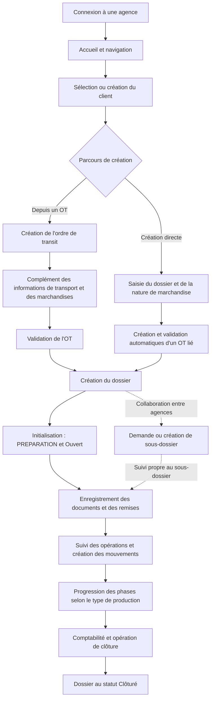
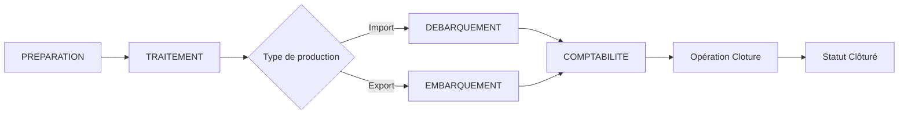
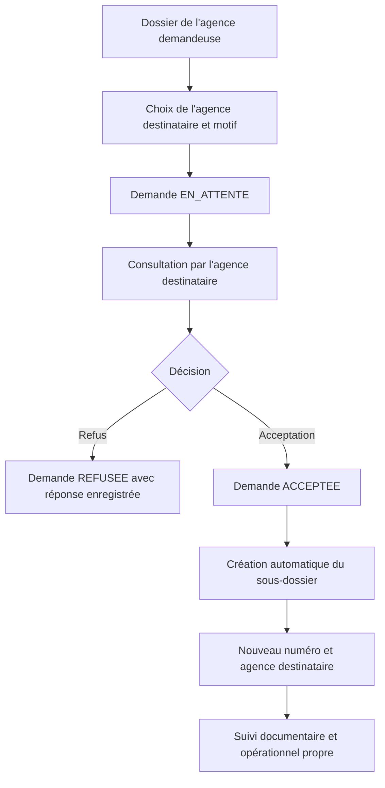

# Fonctionnement et workflow de l’application de centralisation Auximad

## 1. Objectif et organisation générale

L’application centralise les informations nécessaires au suivi des opérations de transit des agences Auximad. Elle relie les clients, les ordres de transit, les marchandises, les contrats de transport, les dossiers, les documents et les mouvements dans une même base de données.

Le **dossier** constitue le point central du suivi opérationnel. Il possède un numéro, une agence responsable, un client, un type de production, une phase et un statut. Sa fiche permet de consulter les informations de transport et de livraison, les documents remis, les conteneurs associés et les relations avec d’autres agences.

Le fonctionnement comprend un parcours principal, allant de la création de l’ordre de transit à la clôture du dossier, et des parcours complémentaires : création directe d’un dossier, collaboration entre agences, correction des mouvements, consultation des historiques et utilisation de l’assistant conversationnel.

Cette description est fondée sur les vues, les services métier et les scripts SQL du dépôt. Les exemples d’opérations correspondent au référentiel fourni ; leur ordre et leurs propriétés peuvent évoluer avec le paramétrage de l’application.

## 2. Utilisateurs, agences et droits d’accès

La connexion associe chaque utilisateur à une agence. Le référentiel propose les rôles **Admin**, **Agent**, **ChefAgence**, **Lecteur** et **Validateur**. Les actions disponibles dépendent du niveau d’autorisation attribué à l’utilisateur et de leur portée : son agence ou l’ensemble des agences.

Les droits distinguent la consultation, l’écriture, la suppression et la validation. Par exemple, le code prévoit des seuils différents pour créer un ordre de transit, le valider ou intervenir sur un sous-dossier. Les listes de dossiers, les demandes entre agences et certains suivis documentaires appliquent un filtre d’agence lorsque l’utilisateur ne possède pas les droits de consultation globale.

L’espace d’administration exige un niveau d’autorisation d’au moins **10000**. Il permet de gérer les comptes, les autorisations et les référentiels utilisés par les formulaires et les workflows.

## 3. Vue d’ensemble du parcours principal

Ce schéma décrit le parcours courant. Les règles documentaires, les opérations obligatoires et les ajustements manuels déterminent l’avancement réel de chaque dossier.

## 4. Connexion et ouverture de la session

L’utilisateur renseigne son **nom d’utilisateur**, le **code de son agence** et son **mot de passe**. Le serveur recherche le compte correspondant, vérifie une éventuelle suspension et contrôle le mot de passe.

La configuration du projet prévoit une suspension de **15 minutes après 3 tentatives de mot de passe échouées** pour un compte identifié. Une connexion réussie réinitialise le compteur et produit un jeton JWT contenant notamment l’identité, l’agence, le rôle et le niveau d’autorisation.

L’interface conserve le jeton et les informations de l’utilisateur, puis ouvre la page d’accueil. Les requêtes vers les API protégées transmettent ce jeton. La configuration actuelle prévoit une durée de validité de **24 heures**.

L’accueil donne accès aux principaux modules. La navigation propose notamment les clients, les ordres de transit, les marchandises, les conteneurs, les dossiers, les demandes entre agences, les documents et les historiques. Lors de la déconnexion, l’interface signale l’action au serveur pour l’audit, efface les informations de session et ramène l’utilisateur au parcours de connexion.

## 5. Préparation de l’opération : client et ordre de transit

### 5.1. Identification du client

L’utilisateur recherche un client existant ou crée sa fiche. Celle-ci regroupe les informations d’identité, les coordonnées, le type de client, le pays et les références telles que le NIF et le STAT. Le client peut ensuite être sélectionné dans les formulaires d’ordre de transit et de dossier.

### 5.2. Création de l’ordre de transit

L’ordre de transit, abrégé **OT**, rassemble les informations initiales de l’opération. Son formulaire suit quatre étapes :

| Étape du formulaire | Informations et actions principales |
| --- | --- |
| Donneur d’ordre et régime | Choix du client, du type de production, du régime et de la nature de la marchandise. |
| Destinations et acteurs | Choix de l’expéditeur, du destinataire et du bureau de dédouanement ; complément des acteurs concernés. |
| Contrat de transport | Saisie des références du transport, adaptées au mode maritime ou aérien : compagnie, navire ou vol, référence BL/LTA et dates. |
| Consultation et validation du formulaire | Relecture des informations et confirmation de la création. |

À l’enregistrement, le serveur associe l’OT à l’utilisateur et à son agence. Il lui attribue un numéro séquentiel, commençant à **10001** lorsqu’aucun OT n’existe, et le statut **Non valide**. Le contrat et l’expédition peuvent être enregistrés avec l’OT.

La confirmation de création du formulaire et la validation métier de l’OT sont deux actions distinctes : un OT nouvellement créé attend encore sa validation métier.

### 5.3. Complément et validation de l’OT

La fiche de l’OT permet de consulter et de compléter le contrat de transport, les instructions et les marchandises. Les marchandises sont rattachées à l’OT et décrites par leur marque, leur modèle, leur description, leur quantité, leur poids, leur volume et leur unité de mesure.

La nature de marchandise portée par l’OT intervient aussi dans le choix des documents applicables au dossier. Elle est requise lors de la création de l’OT.

Après validation métier, l’OT prend le statut **Valide**. Il peut alors servir de base à la création d’un dossier. Le référentiel contient également un statut **Brouillon**, mais le service de création actuel initialise les nouveaux OT au statut **Non valide**.

## 6. Ouverture du dossier

### 6.1. Création à partir d’un OT existant

L’utilisateur recherche l’OT par son numéro ou le sélectionne dans les suggestions. L’interface reprend son client et son type de production. Il complète ensuite les données du dossier : pays, incoterm, échéance, livraison, prépaiement du fret, provision et indication de groupage, selon le besoin.

Si l’OT n’est pas encore validé, l’interface demande de confirmer sa validation avant de poursuivre. Le serveur exige que l’OT soit validé pour enregistrer le dossier.

Une règle empêche la création de plusieurs dossiers pour **le même OT dans la même agence**. Le même OT peut toutefois être utilisé dans une autre agence, notamment pour un sous-dossier interagence.

### 6.2. Création directe

Le formulaire permet aussi de créer un dossier sans sélectionner un OT existant. L’utilisateur renseigne le client, le type de production et la nature de marchandise. Le serveur crée alors un OT lié, l’associe à l’utilisateur et à l’agence, puis le valide automatiquement avant d’enregistrer le dossier.

Ce parcours permet d’ouvrir le suivi du dossier à partir d’informations initiales réduites. Les informations de l’OT peuvent ensuite être complétées.

### 6.3. Numérotation et état initial

Le serveur génère le numéro du dossier par concaténation, sans séparateurs, des éléments suivants :

**Code du type de production + code agence sur 2 chiffres + mois sur 2 chiffres + dernier chiffre de l’année + chronologie sur 4 chiffres.**

Par exemple, un dossier de type import maritime de code `1`, créé par l’agence de code `10` en octobre 2026 avec la chronologie `0001`, reçoit le numéro `1101060001`.

Le dossier est initialisé en phase **PREPARATION**, avec le statut **Ouvert**. Les documents sélectionnés dans le formulaire de création sont ensuite enregistrés et peuvent déclencher son avancement automatique. L’enregistrement du dossier et celui de cette sélection documentaire sont deux requêtes successives : si la seconde échoue, le dossier reste créé et l’interface signale que ses documents doivent être repris.

## 7. Constitution et contrôle des documents

### 7.1. Documents applicables et remises

L’application affiche les types de documents applicables au type de production du dossier et à la nature de marchandise de son OT. Elle distingue les documents obligatoires et facultatifs.

L’utilisateur peut enregistrer la remise d’un type de document, renseigner sa date et joindre un fichier. Le service autorise aussi l’enregistrement d’un document remis sans fichier numérique. Les contrôles de complétude reposent sur la présence d’un **document actif du type attendu**.

La base conserve les informations du document et de sa remise. Le fichier joint est stocké sur le serveur et peut être prévisualisé ou téléchargé depuis l’interface. Les mises à jour peuvent être réalisées document par document ou en lot.

### 7.2. Avancement automatique de la préparation

Après l’ajout, l’assignation, le retrait ou la suppression d’un document via le module documentaire, le serveur réévalue le dossier.

Lorsque tous les types de documents obligatoires applicables sont présents et que le dossier est encore en **PREPARATION**, le workflow :

1. Enregistre automatiquement les opérations de préparation qui n’ont pas encore été effectuées.
2. Identifie ces mouvements avec l’origine **DOCUMENTS**.
3. Fait passer le dossier à la phase suivante du flux, généralement **TRAITEMENT** pour les parcours import et export fournis.

Lorsque le paramétrage ne définit aucun document obligatoire applicable, la condition de complétude est satisfaite dès l’ouverture du dossier ; le passage dépend alors de l’existence d’une phase suivante dans son flux.

### 7.3. Contrôle propre à chaque opération

Le workflow applique également une règle documentaire à chaque opération. Une table d’association définit les types de documents requis pour cette opération. Le serveur vérifie uniquement ces prérequis lors de la création de son mouvement, en tenant compte de la nature de marchandise.

Une opération sans document requis peut donc être réalisée dès que ses opérations obligatoires précédentes sont terminées. Lorsqu’un document manque, l’interface de mouvement peut ouvrir une fenêtre pour l’enregistrer, puis retenter l’opération.

### 7.4. Retrait d’un document obligatoire

Si le dossier avait avancé automatiquement grâce à ses documents et qu’un document obligatoire est retiré, le workflow annule les mouvements actifs à partir du premier mouvement d’origine **DOCUMENTS**, puis recalcule la phase et le statut.

Cette règle peut remettre en cause les mouvements enregistrés après cette préparation automatique. Les mouvements annulés restent consultables dans l’historique.

## 8. Traitement et progression du dossier

### 8.1. Phase, statut, opération et mouvement

| Notion | Fonction dans le suivi |
| --- | --- |
| Phase | Situe le dossier dans une grande étape : préparation, traitement, débarquement ou embarquement, comptabilité. |
| Statut | Décrit sa situation générale : Ouvert, Clôturé, Annulé ou En litige dans le référentiel fourni. |
| Opération | Définit une tâche du flux, avec un ordre, une phase, un éventuel statut et un caractère obligatoire ou facultatif. |
| Mouvement | Enregistre la réalisation ou l’ajustement d’une étape pour un dossier donné, avec l’auteur, la date et les anciens et nouveaux états. |

L’avancement est calculé à partir des opérations actives associées au **type de production**. Elles sont ordonnées par leur niveau d’opération, puis par leur identifiant en cas d’égalité.

### 8.2. Enregistrement d’un mouvement

Dans l’écran de traitement, l’utilisateur sélectionne un dossier et consulte ses opérations. Chaque ligne indique si l’opération est effectuée, disponible ou bloquée par une opération obligatoire précédente.

Pour enregistrer un mouvement, le serveur contrôle que l’opération appartient au flux du dossier, qu’elle est active, que ses documents requis sont remis et qu’elle n’a pas déjà été effectuée. Il vérifie aussi qu’aucune opération obligatoire antérieure ne bloque sa réalisation.

Si les contrôles réussissent, il enregistre le mouvement avec l’utilisateur connecté, la date, les anciens et nouveaux états et, lorsqu’il est fourni, un fichier joint. Il met ensuite à jour le dossier et l’interface recharge le suivi.

Une opération obligatoire incomplète bloque les opérations suivantes. Une opération facultative incomplète laisse poursuivre le flux. Lorsque toutes les opérations obligatoires d’une phase sont effectuées, le workflow passe à la phase suivante disponible. Une opération peut également appliquer le statut qui lui est associé.

### 8.3. Parcours import et export du référentiel fourni

| Phase | Exemples d’opérations du flux import | Exemples d’opérations du flux export |
| --- | --- | --- |
| PREPARATION | Réservation TC/Ligne, Réception BL/LTA, Position Container. | Avis d’arrivée client, Première réception de documents, Premier envoi de documents, Expédiée. |
| TRAITEMENT | Déclaration, Dispatch/Passeur, Dépôt Déclaration, Visite Douane. | Déclaration, Dispatch/Passeur, Dépôt Déclaration, Visite Douane. |
| DEBARQUEMENT / EMBARQUEMENT | Départ Camion, Arrivée Camion, Mise à quai, Taxation BAE, Closing date. | Bon à enlever, Sortie Aéro/Port, Taxation, Livraison. |
| COMPTABILITE | Provision, Facturation, Transmission, Paiement, Clôture. | Provision, Facturation, Transmission, Paiement, Clôture. |

Dans ces données, **Information Client** et **Provision** sont facultatives. L’opération **Cloture** applique le statut **Clôturé** ; les autres opérations du parcours sont associées au statut **Ouvert**. Les opérations de facturation et de paiement sont suivies par l’enregistrement de mouvements.

Le référentiel propose aussi les types de production « divers » et « colis postaux ». Leur progression dépend des opérations effectivement paramétrées pour eux.

### 8.4. Déclaration et conteneurs

Pour les opérations de déclaration, l’interface propose un formulaire dédié : numéro, date, bureau, type de déclaration, description et éventuel fichier. Elle enregistre la déclaration, puis tente d’effectuer le mouvement si l’opération n’est pas encore réalisée. Les règles documentaires et d’ordre restent applicables à ce mouvement.

Les conteneurs peuvent être affectés aux dossiers éligibles, notamment maritimes ou combinés. L’application réutilise un conteneur existant lorsqu’elle retrouve son numéro et conserve ses autres associations. Un même conteneur peut donc être lié à plusieurs dossiers.

## 9. Collaboration entre agences

### 9.1. Demande d’intervention

Depuis la fiche du dossier, une agence choisit une agence destinataire et renseigne un motif. L’application enregistre une demande au statut **EN_ATTENTE** et la signale dans la navigation de l’agence destinataire.

La destination doit être différente de l’agence demandeuse. Une seule demande en attente est autorisée pour un dossier. Tant que la demande reste en attente, l’agence émettrice, ou un utilisateur disposant des droits globaux nécessaires, peut la modifier.

### 9.2. Acceptation ou refus

L’agence destinataire, ou un utilisateur disposant des droits globaux nécessaires, répond à la demande. La réponse conserve son auteur, sa date et son motif. Une demande déjà traitée ne peut pas recevoir une nouvelle réponse.

Un refus clôt le parcours de cette demande au statut **REFUSEE**. Une acceptation lui attribue le statut **ACCEPTEE** et crée automatiquement un sous-dossier dans l’agence destinataire.

### 9.3. Fonctionnement du sous-dossier

Le sous-dossier est un nouveau dossier relié au dossier mère. Il reprend notamment le client, l’OT, les pays, l’incoterm et certaines indications logistiques. Il reçoit son propre numéro et son agence ; son type de production peut être choisi lors d’une création directe de sous-dossier, sinon il reprend celui du dossier mère.

Le service d’ouverture initialise son suivi en **PREPARATION / Ouvert**, même lorsque le dossier mère est déjà avancé. Ses documents, remises et mouvements sont suivis séparément. La provision est réinitialisée lors de sa création.

La fiche permet de retrouver le dossier mère et les sous-dossiers associés. Le projet propose également un parcours de création directe de sous-dossier, en complément du parcours par demande et acceptation.

## 10. Corrections, annulations et suppressions

### 10.1. Annulation d’un mouvement

Avant une annulation, l’application calcule son impact et présente les mouvements concernés. Annuler une opération facultative conserve les autres mouvements. Annuler une opération obligatoire peut aussi annuler les mouvements exécutés ensuite et situés plus loin dans le flux, ainsi que les transitions ultérieures sans opération.

Lorsque des opérations obligatoires ont déjà été effectuées après le mouvement choisi, le serveur exige une confirmation explicite. Chaque annulation conserve sa date, son auteur et son motif.

Le dossier reprend les états portés par le dernier mouvement encore actif. Lorsqu’aucun mouvement actif ne subsiste, il revient à son état initial **PREPARATION / Ouvert**.

### 10.2. Ajustement manuel de la phase ou du statut

La fiche du dossier permet de demander un changement de phase ou de statut. L’interface demande une confirmation, car ce changement peut produire ou annuler des mouvements.

Pour une avancée vers une phase ultérieure, le serveur crée automatiquement les opérations encore absentes des phases précédentes et enregistre une transition de phase. Un retour vers une phase antérieure annule les mouvements concernés avant de repositionner le dossier.

Pour un statut associé à une opération, comme **Clôturé**, le serveur peut enregistrer automatiquement les opérations manquantes jusqu’à cette opération. Le retour au statut **Ouvert** annule les mouvements concernés selon le dernier ajustement ou changement de statut, puis recalcule l’état.

Ces traces portent des origines d’ajustement, telles que **AJUSTEMENT**, **AJUSTEMENT_PHASE** ou **AJUSTEMENT_STATUT**. Elles identifient les changements manuels de l’avancement. Les contrôles appliqués à ces ajustements diffèrent de ceux de la saisie individuelle d’un mouvement : les opérations générées automatiquement ne passent pas par le contrôle documentaire de cette saisie.

### 10.3. Suppression définitive

La suppression utilise un parcours de confirmation fondé sur son impact réel : éléments supprimés, associations retirées et éventuels dossiers clôturés. Le serveur recalcule cet impact avant l’exécution ; si les données liées ont changé, une nouvelle confirmation peut être demandée.

La suppression d’un dossier traite ses dépendances et ses associations. Lors de la suppression d’un OT, les dossiers liés peuvent être conservés, détachés de l’OT et placés au statut **Clôturé**. Si le schéma impose un lien obligatoire empêchant ce détachement, cette suppression est refusée pour conserver les dossiers.

Le retrait d’une affectation de conteneur tient également compte de ses autres dossiers associés. Le message de confirmation présente les éléments concernés avant toute modification définitive.

## 11. Consultation, rappels, exports et traçabilité

Les listes proposent la recherche, des filtres, le tri et la pagination. Pour les dossiers, les critères couvrent notamment le client, l’OT, l’agence, le type de production, la phase, le statut, les dates, les informations de livraison et la complétude documentaire.

La navigation actualise ses indicateurs toutes les **15 secondes**. Elle signale les demandes interagences en attente et non vues, ainsi que les dossiers nécessitant une attention documentaire. Ce suivi regroupe les dossiers incomplets et ceux dont une date de remise se situe dans les **7 prochains jours**.

Les tableaux équipés du module d’export permettent de produire un **PDF**, un fichier **Excel** ou une impression. L’export récupère l’ensemble des résultats correspondant aux filtres appliqués, sur toutes les pages. Des fiches individuelles de dossier et d’OT peuvent également être produites.

La traçabilité comprend deux suivis : l’historique métier des mouvements, avec les événements de création et d’annulation, et le journal des actions sur l’API, avec les connexions, consultations, créations, modifications et suppressions. Les lectures automatiques fréquentes et la consultation du journal lui-même font l’objet d’exclusions pour limiter les entrées répétitives.

## 12. Workflow de l’assistant conversationnel

L’utilisateur peut ouvrir l’assistant depuis la navigation et poser une question sur les dossiers ou les activités. Le serveur prépare un contexte à partir d’une base de connaissances interne et des données de l’application, puis l’envoie au modèle local configuré dans Ollama.

L’assistant peut demander l’exécution d’outils métier pour rechercher des informations ou proposer une action. Les outils disponibles tiennent compte de l’utilisateur connecté et de ses autorisations.

Une action d’écriture suit un parcours supplémentaire : présentation de l’opération proposée, mise en attente, saisie du nom d’utilisateur connecté et confirmation. Le serveur vérifie l’identifiant et les droits avant d’exécuter l’outil. Un refus ou un identifiant incorrect interrompt l’action en attente.

Les échanges sont conservés en mémoire côté serveur pour chaque utilisateur et peuvent être réinitialisés. Le fonctionnement de ce module dépend de la disponibilité du service Ollama et du modèle configuré, actuellement `qwen2.5:3b`.

## 13. Administration du workflow

L’administrateur prépare les référentiels utilisés dans les formulaires : agences, bureaux, modes de transport, types de production, régimes, natures de marchandise, types de documents, phases et statuts. Il gère aussi les utilisateurs, leurs autorisations et les suspensions de connexion.

Le paramétrage des opérations définit le flux d’un type de production : description de la tâche, ordre d’exécution, phase, statut associé, caractère obligatoire et activation. L’interface d’administration permet notamment de réordonner les opérations et de modifier leurs propriétés.

Le moteur de suivi utilise ces opérations actives pour calculer les blocages et la progression des dossiers. Les règles de documents requis par opération reposent sur les associations enregistrées dans la base.

## 14. Exemple de parcours complet

Pour un dossier d’import maritime, un agent se connecte à son agence, sélectionne le client et crée l’OT. Il renseigne la nature de marchandise, les acteurs et les références de transport, puis complète les marchandises et fait valider l’OT.

Il ouvre ensuite le dossier et renseigne les informations logistiques et financières de suivi. Le système génère son numéro et l’initialise en préparation. L’agent enregistre les documents applicables ; lorsque les documents obligatoires sont complets, le système produit les mouvements de préparation et passe au traitement.

Les intervenants enregistrent les opérations successives. Chaque mouvement doit respecter l’ordre des opérations obligatoires et les prérequis documentaires qui lui sont propres. La fin du traitement fait progresser le dossier vers le débarquement, puis vers la comptabilité selon le flux paramétré.

Si une autre agence doit intervenir, une demande est envoyée. Son acceptation ouvre un sous-dossier dont cette agence suit séparément les documents et les opérations. Les deux dossiers restent reliés pour la consultation.

Après les opérations de facturation, de transmission et de paiement du parcours, l’opération de clôture place le dossier au statut **Clôturé**. Les utilisateurs retrouvent les informations enregistrées, les mouvements et leurs éventuelles annulations dans les écrans de consultation et d’historique.

## Sources de l’analyse dans le projet

| Partie étudiée | Fichiers de référence |
| --- | --- |
| Connexion, session et autorisations | [AuthentificationService.java](backend/src/main/java/com/auximad/service/AuthentificationService.java), [AutorisationHelper.java](backend/src/main/java/com/auximad/security/AutorisationHelper.java), [router/index.js](frontend/src/router/index.js). |
| Création de l’OT et du dossier | [OrdreTransitService.java](backend/src/main/java/com/auximad/service/OrdreTransitService.java), [OrdreTransitWizardView.vue](frontend/src/views/OrdreTransitWizardView.vue), [DossierService.java](backend/src/main/java/com/auximad/service/DossierService.java), [DossierCreateView.vue](frontend/src/views/DossierCreateView.vue). |
| Progression, documents et corrections | [DossierWorkflowService.java](backend/src/main/java/com/auximad/service/DossierWorkflowService.java), [MvtDossierService.java](backend/src/main/java/com/auximad/service/MvtDossierService.java), [DocumentService.java](backend/src/main/java/com/auximad/service/DocumentService.java), [DocumentController.java](backend/src/main/java/com/auximad/controller/DocumentController.java). |
| Parcours entre agences | [DemandeInteragenceService.java](backend/src/main/java/com/auximad/service/DemandeInteragenceService.java), [InterAgenceService.java](backend/src/main/java/com/auximad/service/InterAgenceService.java). |
| Suppressions et traçabilité | [SuppressionService.java](backend/src/main/java/com/auximad/service/SuppressionService.java), [AuditInterceptor.java](backend/src/main/java/com/auximad/config/AuditInterceptor.java). |
| Rappels, exports et assistant | [Header.vue](frontend/src/components/inc/Header.vue), [DataTable.vue](frontend/src/components/inc/DataTable.vue), [ChatService.java](backend/src/main/java/com/auximad/ai/ChatService.java). |
| Configuration des flux | [OperationDossierService.java](backend/src/main/java/com/auximad/service/OperationDossierService.java), [donne_deepseek.sql](backend/bdd/donne_deepseek.sql). |
